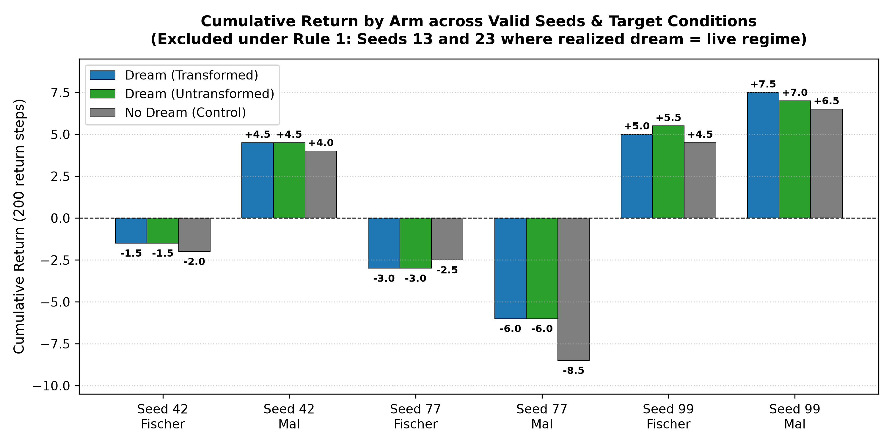
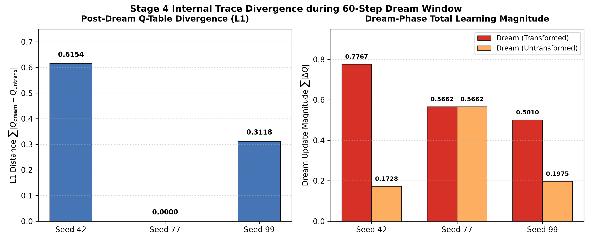
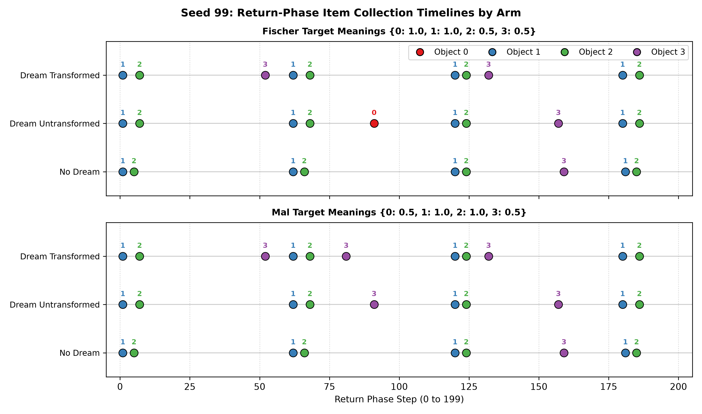

# Remnant

> An exploratory tabular reinforcement learning prototype studying whether transformed versus faithful dream content changes how an agent later adapts to silent environment shifts.

[](https://github.com/shiningshotgun/remnant/actions/workflows/tests.yml)
[](LICENSE)

---

## About

**Remnant** investigates an agent's behavioral adaptation under silent shifts in environmental meaning. 

In a discrete $5 \times 5$ gridworld, an agent learns to act via tabular Q-learning with non-parametric episodic memory. During its lifetime, the meanings (reward values) of objects silently shift across regimes, and the agent constructs a learned transition and reward world model from its experience. Mid-episode at step $t=5$, the agent is suspended, injected into an episode simulated entirely within its own learned world model ("dream phase") under transformed meanings, and subsequently returned to the simulator under a prespecified target regime.

The experimental machinery isolates the specific effect of dream transformation by comparing three strictly paired arms under identical initial randomness:
1. **`dream` (Transformed):** Dream episode inside the learned model under meanings recombined across experienced regimes.
2. **`dream_untransformed` (Faithful):** Dream episode inside the learned model under untransformed meanings (the regime in effect at suspension).
3. **`no_dream` (Control):** Control skipping the dream phase entirely (zero transitions, zero memory writes, zero Q-updates).

> **Status:** Exploratory prototype. Results are single paired draws from a small tabular gridworld; null and mixed findings are reported in full. The project makes no benefit, awareness, or consciousness claims.

---

## Key Experimental Results

Experiments evaluate five prespecified seeds (`[13, 23, 42, 77, 99]`) across two prespecified outer world target conditions: **Fischer** (outer target equals realized dream) and **Mal** (outer target carries a controlled mismatch on uncollected objects). Validity rules prespecify that runs where the realized dream equals the live regime at suspension are excluded (Seeds 13 and 23).

### Terminal Cumulative Returns
Across valid seeds, the transformation attribution contrast (`dream - dream_untransformed`) produced near-zero terminal return differences in Seeds 42 and 77, and modest contrasts in Seed 99:



### Internal Decision-Trace Divergence
Step-by-step passive trace logging (`checkpoints/stage4_runs_v4.json`) demonstrates that the transformation actively changes internal mechanics when meaning-altered objects are visited:



- **Seed 42:** Collecting an altered object on dream step 1 induced significant Q-learning divergence ($\sum |\Delta Q| = 0.7767$ vs $0.1728$; post-dream Q-table $L_1 = 0.6154$). Downstream return actions diverged after step 71, but periodic episode resets and matching collection schedules resulted in identical cumulative return sums (-1.5 vs -1.5, +4.5 vs +4.5).
- **Seed 77:** The single altered object was not collected during the 60 dream steps, yielding an exact mathematical null ($L_1 = 0.0$, 100% trajectory match).
- **Seed 99:** Divergence on dream step 40 resulted in post-dream $L_1 = 0.3118$ and return action divergence at step 41–44, producing return contrasts of -0.50 (Fischer) and +0.50 (Mal).

### Return-Phase Collection Breakdown (Seed 99)
Decomposing return-phase events shows how changed Q-values shifted the timing and identity of collected objects:



---

## Quickstart

The core project library has **zero external dependencies** and uses the Python standard library only. `pytest` and `matplotlib` are used for test verification and figure generation.

### Installation

```bash
git clone https://github.com/shiningshotgun/remnant.git
cd remnant

python3 -m venv .venv
source .venv/bin/activate
pip install -r requirements.txt
```

### Verification & Analysis Commands

All analysis scripts and viewers operate in read-only mode over the committed JSON records:

1. **Run Test Suite:**
   ```bash
   python -m pytest
   ```
   *Runs 16 tests covering environment mechanics, memory invariants, model learning, and full-state passive-logging deterministic equivalence on seed 42 (~1 minute runtime).*

2. **Inspect Decision-Trace Measures:**
   ```bash
   python analyze_decision_traces.py
   ```
   *Computes arithmetic trace measures (action matches, Q-table $L_1$ distances, memory blend impacts) directly from `checkpoints/stage4_runs_v4.json` without simulation or RNG calls.*

3. **Inspect Return Reward Composition:**
   ```bash
   python return_composition_analysis.py
   ```
   *Decomposes return step costs, collection events, and per-object rewards across arms.*

4. **Interactive CLI Trajectory Viewer:**
   ```bash
   python replay.py [optional_path_to_json]
   ```
   *Renders ASCII 5x5 grid state transitions, agent positions, collected items, and running rewards (defaults to `checkpoints/stage4_runs_v4.json`).*

5. **Regenerate Documentation Figures:**
   ```bash
   python scripts/make_figures.py
   ```
   *Reproduces all PNG plots in `docs/images/` from recorded JSON artifacts.*

### Full Protocol Execution

```bash
python run_stage4.py
```
> **Warning:** Running `python run_stage4.py` executes the full 5-seed Stage 4 protocol from scratch and **overwrites** `checkpoints/stage4_runs_v4.json` in place.

---

## Project Structure

```
remnant/
├── remnant/                 # Core library (standard library only)
│   ├── world.py             # 5x5 gridworld environment & layout
│   ├── memory.py            # Episodic memory buffer & similarity lookup
│   ├── model.py             # Empirical world model (transitions & rewards)
│   ├── transform.py         # Counterfactual dream regime transformations
│   └── agent.py             # Tabular Q-learning agent with memory blend
├── tests/                   # Verification test suite
│   ├── test_foundations.py  # 14 foundation tests (rules, mechanics, guards)
│   └── test_equivalence_gate.py # Full-state non-interference equivalence tests
├── scripts/
│   └── make_figures.py      # Reproducible figure generation
├── docs/
│   ├── ANALYSIS.md          # In-depth decision-trace & return analysis
│   └── images/              # Generated publication figures
├── checkpoints/             # Recorded run artifacts and immutable snapshots
│   ├── stage4_runs.json     # Initial condition-integrity run
│   ├── stage4_runs_v2.json  # Restored comparator & coverage run
│   ├── stage4_runs_v3.json  # Paired-stream RNG baseline run
│   └── stage4_runs_v4.json  # Complete 80MB passive decision-trace artifact
├── analyze_decision_traces.py   # Arithmetic trace analysis script
├── return_composition_analysis.py # Return collection decomposition script
├── replay.py                # Terminal ASCII trajectory viewer
├── run_stage12.py           # Stage 1 (Q-eval) & Stage 2 (model accuracy) runner
├── run_stage3.py            # Stage 3 dream environment runner
├── run_stage4.py            # Stage 4 full experiment runner
├── EVIDENCE.md              # Canonical protocol specification & results
├── requirements.txt         # Dev dependencies (pytest, matplotlib)
└── LICENSE                  # MIT License
```

---

## Research Documentation

- [EVIDENCE.md](EVIDENCE.md): Canonical protocol descriptions, validity rules, and verified empirical metrics.
- [docs/ANALYSIS.md](docs/ANALYSIS.md): Comprehensive report on the passive-listener equivalence gate, descriptive measures, and return reward composition.

---

## License

This project is licensed under the [MIT License](LICENSE).
